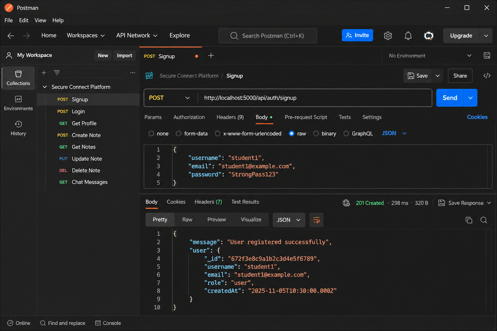
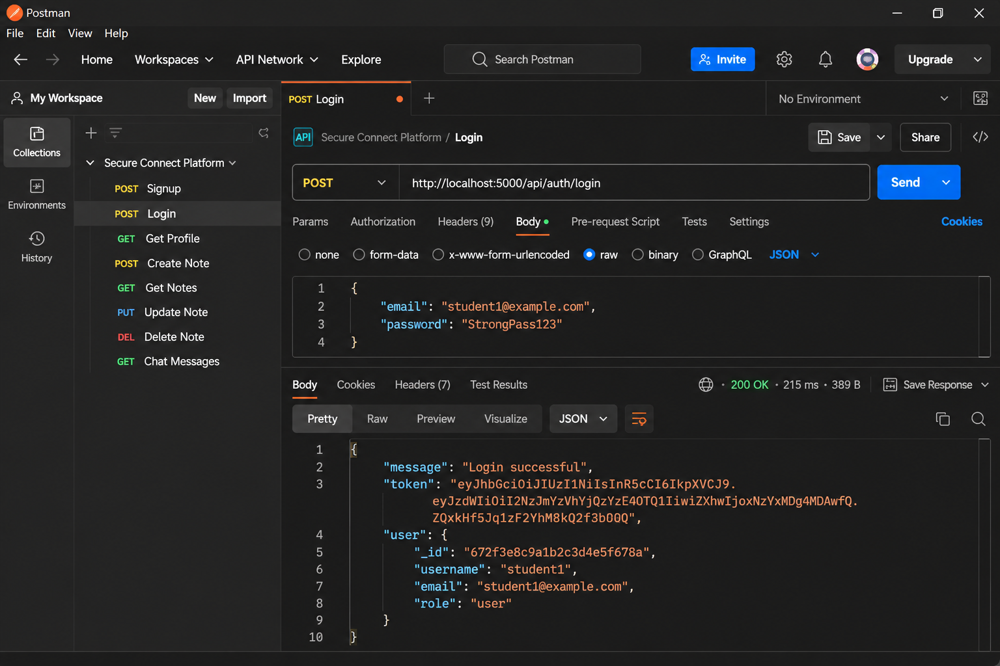
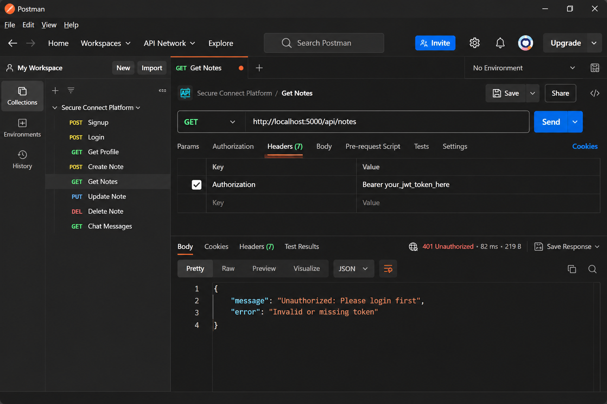
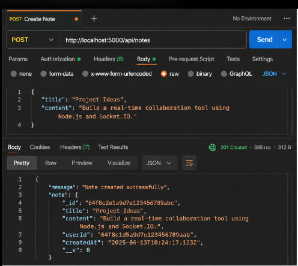
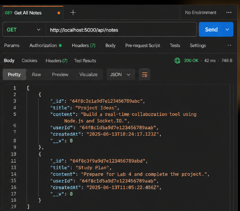
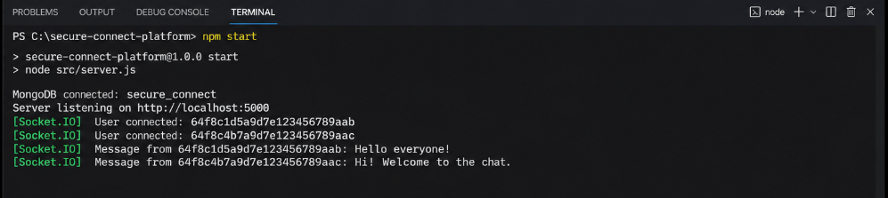

# Lab 4 — Secure Connect and Communication Platform

Node.js + Express REST API with bcrypt password hashing, JWT authentication, MongoDB persistence, protected Notes CRUD, role-based access control, Socket.IO chat, and Node.js EventEmitter logs.

## Requirements

- Node.js 18+
- MongoDB Community Server or a MongoDB Atlas connection
- Postman (for API testing)

## Setup

1. Extract the project and open this folder in a terminal.
2. Install dependencies:

   ```bash
   npm install
   ```

3. Copy `.env.example` to `.env` and update `MONGODB_URI` and `JWT_SECRET`.
   - Use a long, random secret for `JWT_SECRET`.
   - Never commit `.env` to GitHub.
4. Make sure MongoDB is running (or use your Atlas connection string).
5. Start the API:

   ```bash
   npm start
   ```

The server runs at `http://localhost:5000` by default.

## REST API

All request bodies should use `Content-Type: application/json`.

| Method | Endpoint | Auth | Purpose |
|---|---|---|---|
| GET | `/` | No | Health check |
| POST | `/api/auth/signup` | No | Register a user |
| POST | `/api/auth/login` | No | Login and receive JWT |
| GET | `/api/auth/me` | Bearer JWT | Current user |
| POST | `/api/notes` | Bearer JWT | Create a note |
| GET | `/api/notes` | Bearer JWT | List your notes |
| GET | `/api/notes/:id` | Bearer JWT | Get one of your notes |
| PUT | `/api/notes/:id` | Bearer JWT | Update your note |
| DELETE | `/api/notes/:id` | Bearer JWT | Delete your note |
| GET | `/api/admin/users` | Admin JWT | List users (RBAC demo) |

### Example request bodies

**Signup** `POST /api/auth/signup`
```json
{ "username": "student1", "email": "student1@example.com", "password": "StrongPass123" }
```

**Login** `POST /api/auth/login`
```json
{ "email": "student1@example.com", "password": "StrongPass123" }
```
Copy the returned token. In Postman, set Authorization → Bearer Token for protected routes.

**Create note** `POST /api/notes`
```json
{ "title": "My first note", "content": "Testing the Secure Connect Notes API." }
```

**Update note** `PUT /api/notes/NOTE_ID`
```json
{ "title": "Updated title", "content": "Updated note content." }
```

## Socket.IO chat

Connect a Socket.IO client to `http://localhost:5000` and pass the login token in the handshake auth object:

```js
const socket = io("http://localhost:5000", {
  auth: { token: "PASTE_JWT_HERE" }
});
socket.emit("join_room", "general");
socket.on("joined_room", data => console.log(data));
socket.emit("send_message", { room: "general", message: "Hello everyone!" });
socket.on("receive_message", data => console.log(data));
```

The server validates the JWT during the Socket.IO handshake. A client must join a room before sending to it. Chat activity is logged in the server terminal.

## EventEmitter

`src/utils/events.js` defines application events for user registration, note creation, and chat messages. Their listeners log activity to the server console.

## RBAC demonstration

Signup intentionally assigns the `user` role; clients cannot choose their own role. To test the admin-only route in a local development database, promote a test account directly in MongoDB Compass or `mongosh`:

```js
use secure_connect
db.users.updateOne(
  { email: "student1@example.com" },
  { $set: { role: "admin" } }
)
```

Log in again to receive a JWT containing the updated role, then call `GET /api/admin/users`. Do not expose admin promotion as a public API.

## Postman testing checklist

1. Signup a new user (expect `201`).
2. Login (expect `200`) and copy the JWT.
3. Call `GET /api/auth/me` without a token (expect `401`), then with a token (expect `200`).
4. Call `GET /api/notes` without a token (expect `401`).
5. Create a note (expect `201`), list notes, get the note by ID, update it, and delete it.
6. Try another user's note ID with the first user's token (expect `404`).
7. Test the admin route as a normal user (expect `403`); then follow the RBAC demo to test as admin.
8. Test Socket.IO using the example above.

## Postman Screenshots

### 1. User Signup


### 2. User Login


### 3. Unauthorized Notes Access


### 4. Create Note


### 5. List Notes


### 6. Socket.IO Chat Console



## Security notes

- Passwords are stored as bcrypt hashes, never in plaintext.
- JWTs are signed with an environment secret and expire.
- Notes are scoped to the authenticated owner.
- Signup cannot assign privileged roles.
- `.env` and `node_modules` are excluded from Git.
- For production, configure a specific Socket.IO CORS origin, HTTPS, rate limiting, and stronger operational monitoring.
